# Poster catalog

AI-assisted schematic illustrations. Read the accompanying notes before educational reuse.

## EGFR — The Signal Translator

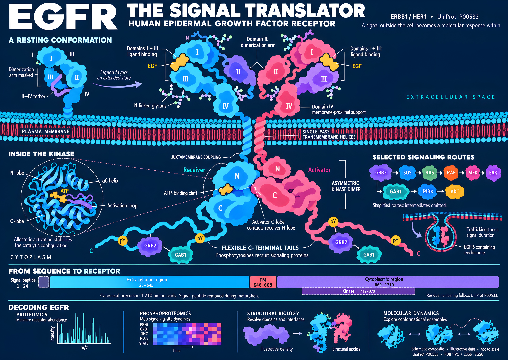

[Download PNG](posters/egfr-signal-translator/egfr-full-length-landscape-flat-v1.png) · [Sources, prompts and limitations](posters/egfr-signal-translator/art-direction-and-prompts.md)

## The Molecular Recycler — Human Proteasome

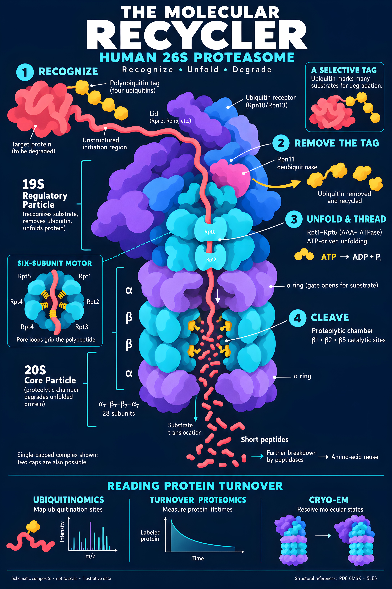

[Download PNG](posters/molecular-recycler/human-proteasome-portrait-flat-v1.png) · [Sources, prompts and limitations](posters/molecular-recycler/art-direction-and-prompts.md)

## The Photon Switch — Rhodopsin

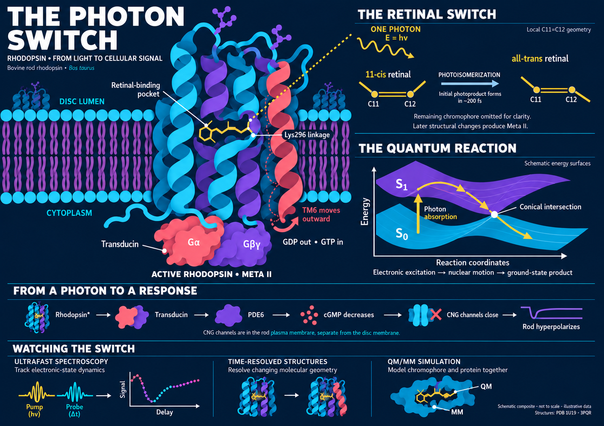

[Download PNG](posters/photon-switch/rhodopsin-landscape-flat-v1.png) · [Sources, prompts and limitations](posters/photon-switch/art-direction-and-prompts.md)

## One Protein, Many Views — Carbonic Anhydrase II

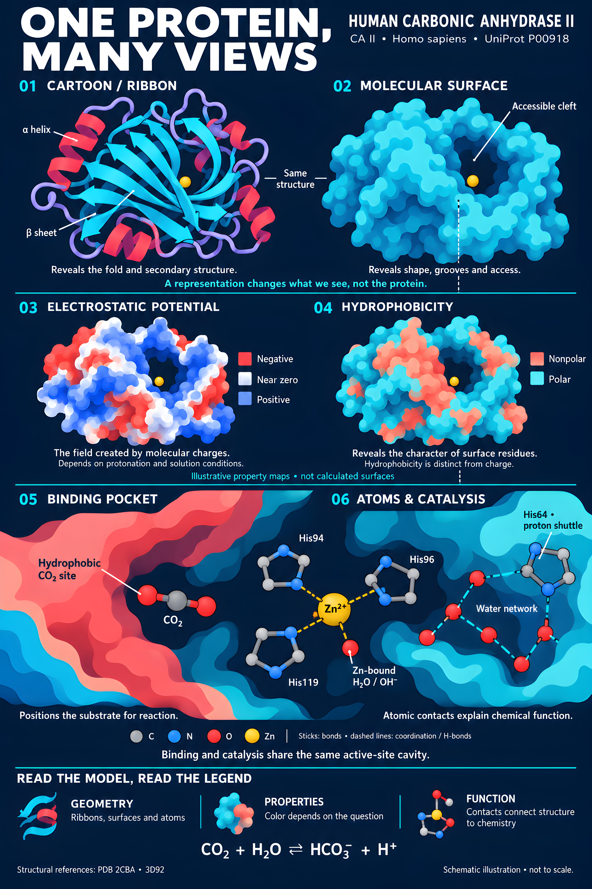

[Download PNG](posters/one-protein-many-views/carbonic-anhydrase-many-views-portrait-v1.png) · [Sources, prompts and limitations](posters/one-protein-many-views/art-direction-and-prompts.md)

## The Protein Universe

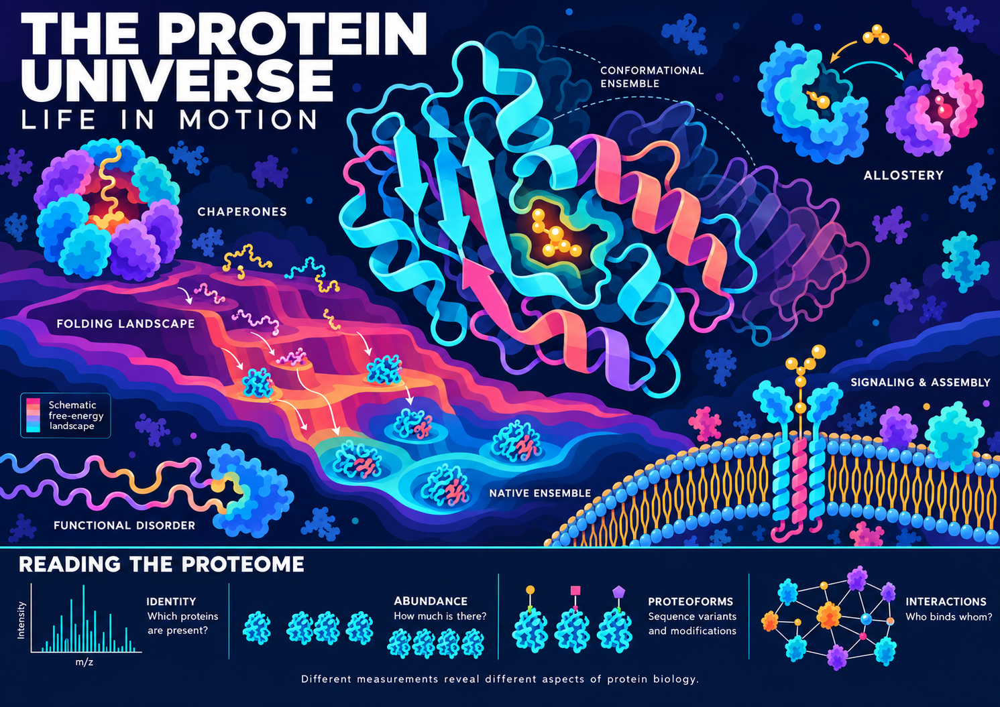

[Download PNG](posters/protein-universe/protein-universe-concept-v1.png) · [Sources, prompts and limitations](posters/protein-universe/art-direction-and-prompts.md)

## The Molecular Motor — ATP Synthase

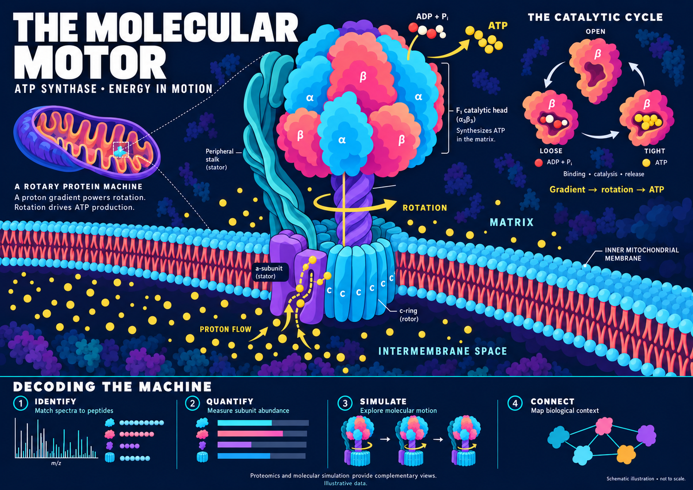

[Download PNG](posters/molecular-motor/atp-synthase-poster-v1.png) · [Sources, prompts and limitations](posters/molecular-motor/art-direction-and-prompts.md)

## The Molecular Walker — Kinesin

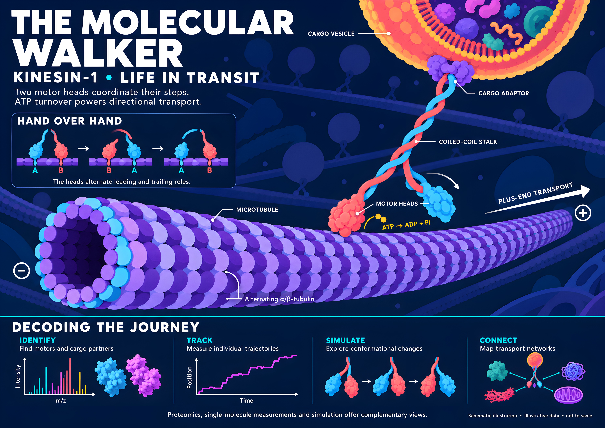

[Download PNG](posters/molecular-walker/kinesin-poster-v1.png) · [Sources, prompts and limitations](posters/molecular-walker/art-direction-and-prompts.md)

## The Molecular Weave — Collagen

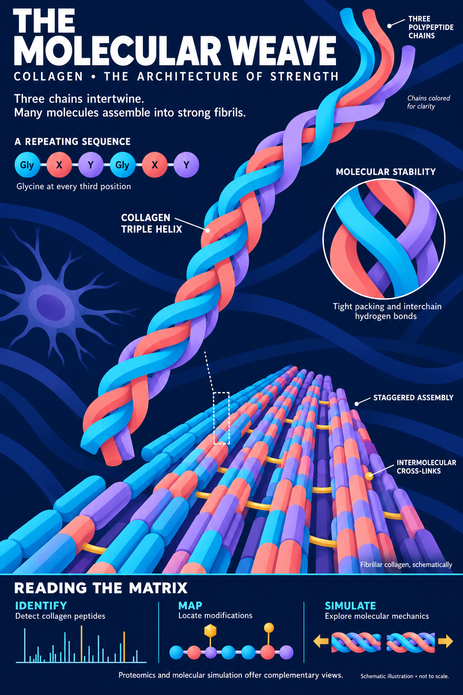

[Download PNG](posters/molecular-weave/collagen-portrait-v1.png) · [Sources, prompts and limitations](posters/molecular-weave/art-direction-and-prompts.md)

## Bacteriophage T4

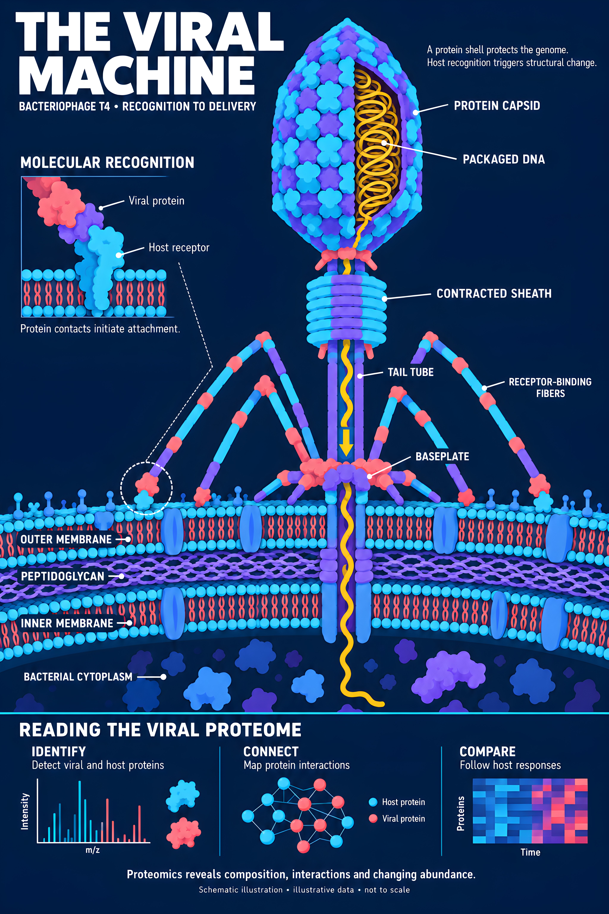

[Download PNG](posters/viral-machine/bacteriophage-t4-portrait-v1.png) · [Sources, prompts and limitations](posters/viral-machine/art-direction-and-prompts.md)

## The Nuclear Gateway

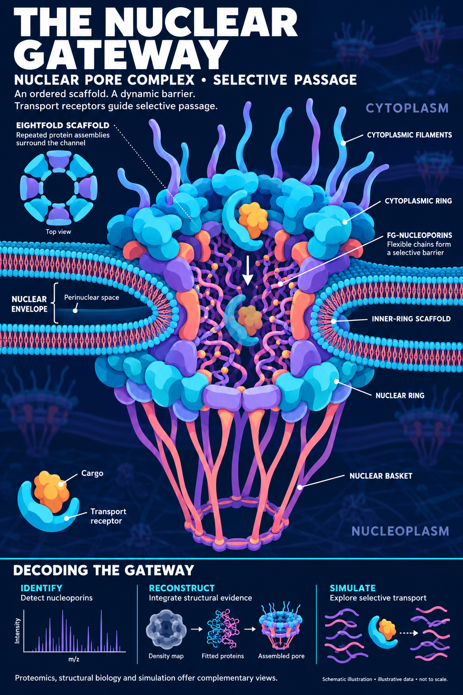

[Download PNG](posters/nuclear-gateway/nuclear-pore-complex-portrait-v1.png) · [Sources, prompts and limitations](posters/nuclear-gateway/art-direction-and-prompts.md)

## The Genome Duplicator — Human Replisome

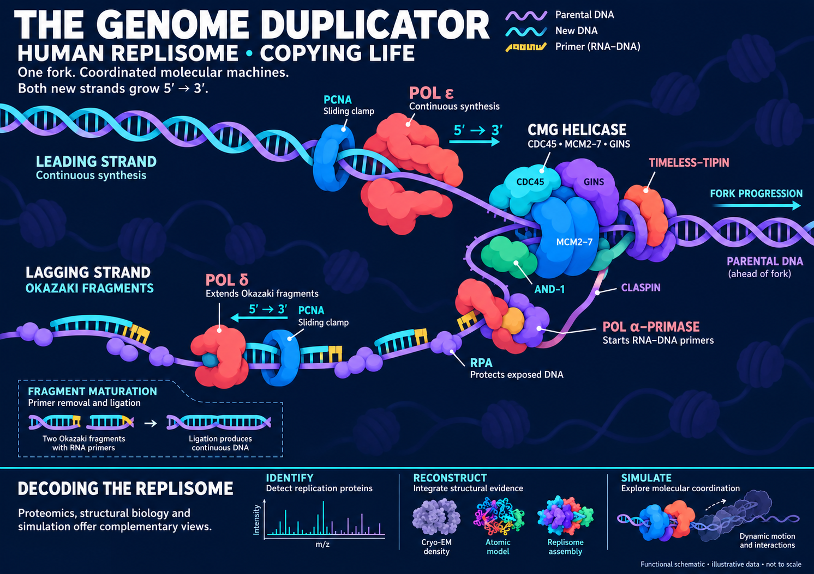

[Download PNG](posters/genome-duplicator/human-replisome-landscape-v1.png) · [Sources, prompts and limitations](posters/genome-duplicator/art-direction-and-prompts.md)

## The Chromosome Anchor — Human Kinetochore

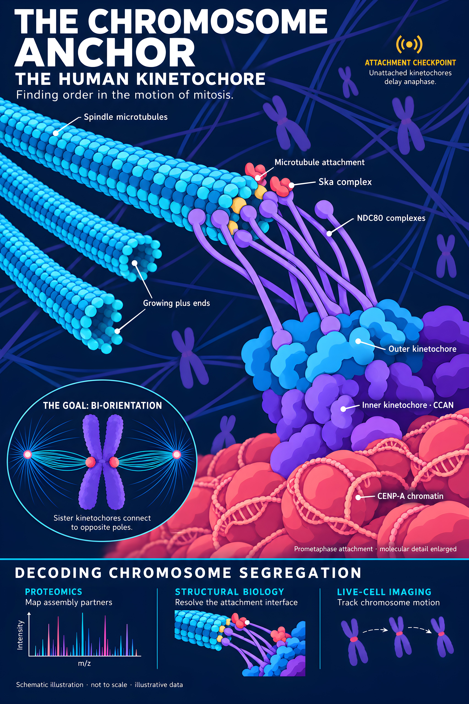

[Download PNG](posters/chromosome-anchor/kinetochore.png) · [Sources, prompts and limitations](posters/chromosome-anchor/art-direction-and-prompts.md)

## The Living Propeller — Bacterial Flagellum

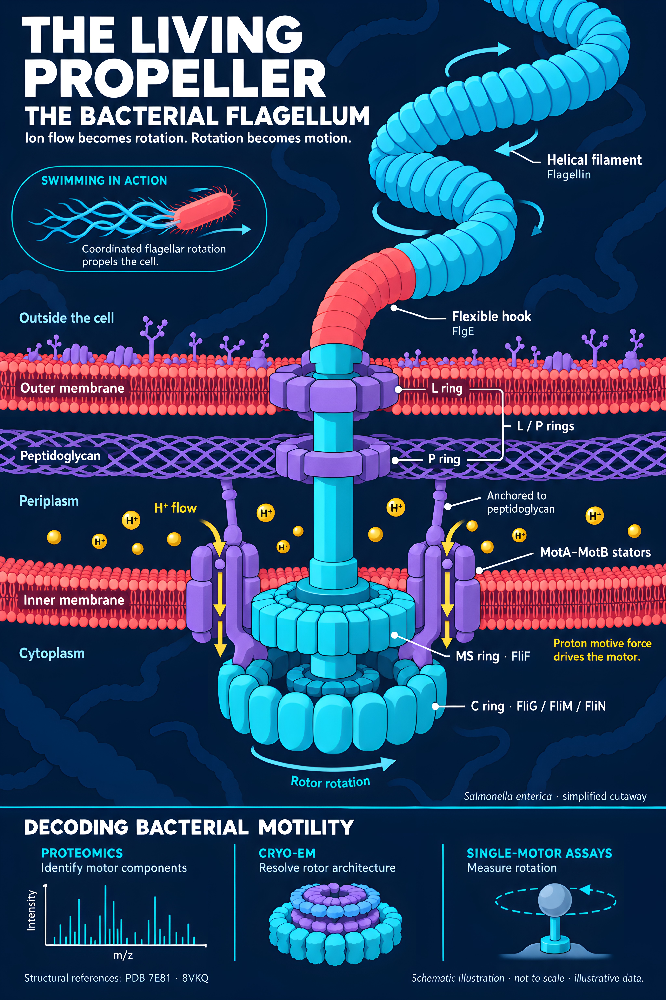

[Download PNG](posters/living-propeller/flagellar_complex.png) · [Sources, prompts and limitations](posters/living-propeller/art-direction-and-prompts.md)

## The Final Breach — Membrane Attack Complex

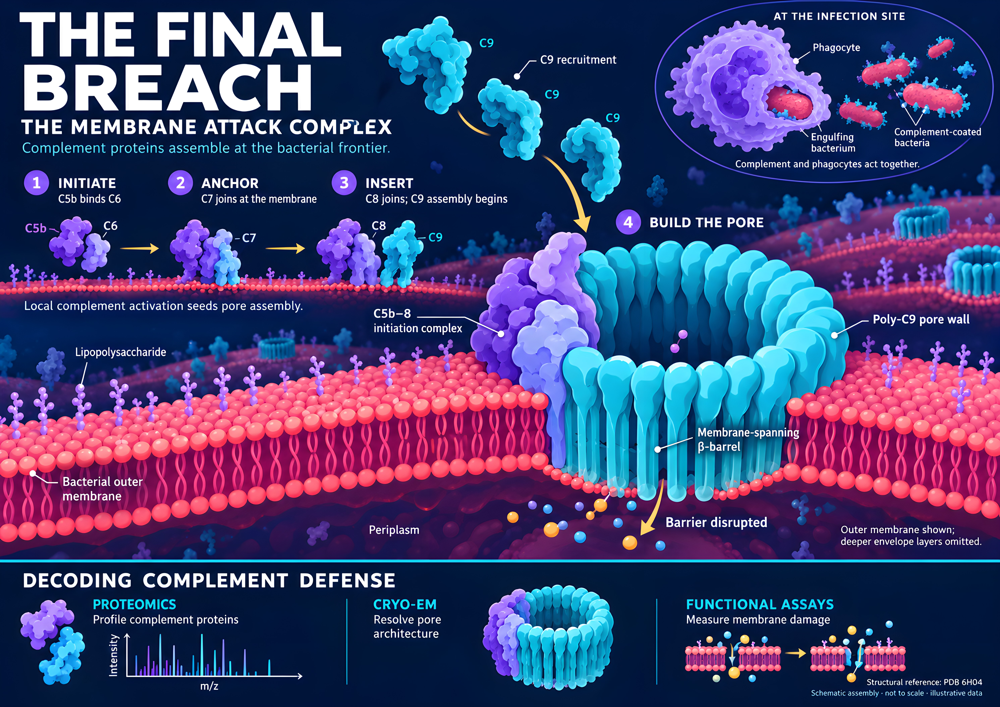

[Download PNG](posters/final-breach/memb_attack_complex.png) · [Sources, prompts and limitations](posters/final-breach/art-direction-and-prompts.md)

## The Molecular Shield — IgG Antibodies and Influenza A

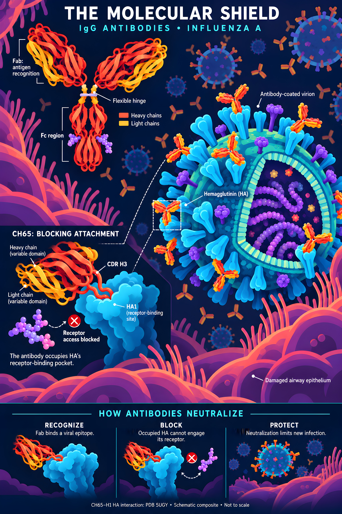

[Download PNG](posters/molecular-shield/igg-antibodies-influenza-a.png) · [Sources, prompts and limitations](posters/molecular-shield/art-direction-and-prompts.md)
